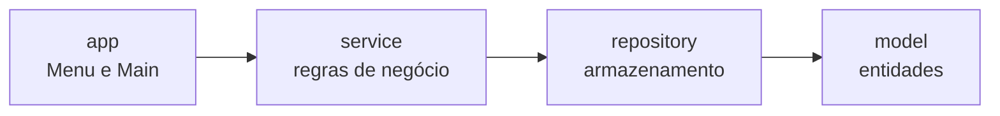

<h1 align="center">🏦 Sistema Bancário</h1>

<p align="center">
  <b>Simulador de operações bancárias em Java, executado no terminal.</b><br>
  Projeto de portfólio com foco em <b>Orientação a Objetos</b>, <b>camadas bem definidas</b> e <b>código limpo</b>.
</p>

<p align="center">
  
  
  
  
</p>

---

> 🚧 **Status:** projeto em desenvolvimento. A seção [Roadmap](#-roadmap) mostra o que já está pronto e o que ainda falta.

## 📑 Sumário

- [Sobre o projeto](#-sobre-o-projeto)
- [Funcionalidades](#-funcionalidades)
- [Tecnologias](#-tecnologias)
- [Arquitetura](#-arquitetura)
- [Estrutura de pastas](#-estrutura-de-pastas)
- [Conceitos de POO aplicados](#-conceitos-de-poo-aplicados)
- [Decisões de design](#-decisões-de-design)
- [Como executar](#-como-executar)
- [Testes](#-testes)
- [Roadmap](#-roadmap)
- [Melhorias futuras](#-melhorias-futuras)
- [Autora](#-autora)

---

## 💡 Sobre o projeto

O **Sistema Bancário** simula as operações básicas de um banco: cadastro de clientes, criação de contas, depósitos, saques, transferências e extrato.

O objetivo não é só funcionar, mas demonstrar **boas práticas**: separação de responsabilidades, regras de negócio isoladas em serviços, exceções personalizadas e uso correto dos pilares da programação orientada a objetos. **Não utiliza frameworks** (como Spring Boot) de propósito, para evidenciar o domínio dos fundamentos da linguagem.

## ✨ Funcionalidades

### 👤 Clientes
- Cadastro com **nome, CPF e data de nascimento**
- **Validação de CPF** (dígitos verificadores) e bloqueio de **CPF duplicado**
- Listagem de clientes

### 💳 Contas
- Criação de **Conta Corrente** e **Conta Poupança**
- **Número da conta gerado automaticamente**
- Cada conta possui número, agência, saldo, titular e histórico de movimentações
- Listagem de contas e consulta dos dados da conta

### 💸 Operações
- **Depositar**
- **Sacar**
- **Transferir** entre contas
- **Consultar saldo**
- **Exibir extrato completo**

### 🔒 Regras de negócio

| Regra | Exceção lançada |
|---|---|
| **Saque maior** que o saldo disponível | `SaldoInsuficienteException` |
| **Transferência** para conta inexistente | `ContaNaoEncontradaException` |
| **Valores** negativos ou zerados | `ValorInvalidoException` |
| **CPF** já cadastrado | `ClienteJaExisteException` |
| **CPF** com formato ou dígitos inválidos | `CpfInvalidoException` |

### 🧾 Histórico
Cada operação gera uma **`Transacao`** com identificador único, tipo, valor, data e hora, conta de origem e conta de destino (quando houver).

## 🛠️ Tecnologias

| Tecnologia | Uso |
|---|---|
| **Java 21 (LTS)** | Linguagem |
| **Maven** | Build e gerenciamento de dependências |
| **JUnit 5** | Testes unitários |
| **Git / GitHub** | Versionamento |

## 🏗️ Arquitetura

O projeto é dividido em **camadas**, e cada camada só conversa com a seguinte:



Os pacotes **`exception`** e **`util`** são transversais: qualquer camada pode usá-los.

| Camada | Responsabilidade |
|---|---|
| **`app`** | Ponto de entrada (`Main`) e interface de terminal (`Menu`). **Não contém regra de negócio.** |
| **`service`** | **Regras de negócio** e orquestração entre repositórios e modelos. |
| **`repository`** | Armazenamento e busca de dados, usando `HashMap`. |
| **`model`** | Entidades do domínio, com seus dados e comportamentos próprios. |
| **`exception`** | Exceções personalizadas de regra de negócio. |
| **`util`** | Geradores de identificadores e validações. |

## 📂 Estrutura de pastas

```
sistema-bancario/
├── pom.xml
├── README.md
└── src/
    ├── main/java/br/com/sistemabancario/
    │   ├── app/          Main, Menu
    │   ├── service/      ClienteService, ContaService, TransacaoService
    │   ├── repository/   ClienteRepository, ContaRepository
    │   ├── model/        Pessoa, Cliente, Conta, ContaCorrente,
    │   │                 ContaPoupanca, Transacao, TipoTransacao, Banco
    │   ├── exception/    NegocioException e exceções específicas
    │   └── util/         GeradorNumeroConta, GeradorNumeroTransacao, Validador
    └── test/java/br/com/sistemabancario/
        ├── model/
        ├── service/
        └── util/
```

## 🎯 Conceitos de POO aplicados

| Conceito | Onde aparece |
|---|---|
| **Encapsulamento** | Atributos privados; o saldo só muda por `depositar` e `sacar`; `Transacao` é imutável |
| **Herança** | `Cliente` herda de `Pessoa`; `ContaCorrente` e `ContaPoupanca` herdam de `Conta`; as exceções herdam de `NegocioException` |
| **Classe abstrata** | `Conta` e `Pessoa` não podem ser instanciadas diretamente |
| **Polimorfismo** | O saque usa `saldoDisponivel()`, que cada tipo de conta implementa à sua maneira |
| **Sobrescrita** | `ContaCorrente` e `ContaPoupanca` sobrescrevem o comportamento da `Conta` |
| **Sobrecarga** | `Transacao` possui construtores com assinaturas diferentes |
| **Composição** | Uma `Conta` possui seu histórico de `Transacao`, que não existe fora dela |
| **Agregação** | Um `Cliente` referencia suas `Conta`s, que também existem no banco |
| **Associação** | Uma `Conta` conhece seu titular (`Cliente`) |

## 🧠 Decisões de design

- **`BigDecimal` para dinheiro.** `double` não representa decimais com exatidão (`0.1 + 0.2` resulta em `0.30000000000000004`). Em sistemas financeiros, o correto é `BigDecimal`.
- **Exceções checked.** As exceções de negócio estendem `Exception`, o que **obriga o tratamento explícito** em operações financeiras.
- **`Conta` é classe abstrata, não interface.** Ela tem **estado** (saldo, histórico) e comportamento compartilhado, o que é papel de classe abstrata.
- **Regras próprias da conta ficam na `Conta`.** `sacar()` e `depositar()` pertencem ao objeto, o que permite **polimorfismo**. O service orquestra o que envolve mais de uma conta, como a transferência.
- **`Transacao` imutável.** Uma operação que já aconteceu **não pode ser alterada**. Ela guarda os números das contas, e não os objetos, para evitar dependência circular.
- **`HashMap` nos repositórios.** Busca por chave (CPF ou número da conta) em tempo **O(1)**.
- **Geradores como classes de instância.** Sem estado estático, o que facilita os testes e a futura persistência.

## ▶️ Como executar

### Pré-requisitos

- **JDK 21** (`java -version` e `javac -version` devem mostrar a versão 21)
- **Maven 3.6+** (`mvn -version`)
- **Git**

### Passo a passo

```bash
# 1. Clonar o repositório
git clone https://github.com/MariaEduardaAlves835/sistema-bancario.git
cd sistema-bancario

# 2. Compilar
mvn clean compile

# 3. Executar (disponível quando a camada app estiver concluída)
mvn exec:java
```

## ✅ Testes

```bash
mvn test
```

Os testes unitários usam **JUnit 5** e ficam em `src/test/java`, espelhando a estrutura dos pacotes de `src/main/java`.

## 🗺️ Roadmap

- [x] Configuração do projeto (Maven, Java 21, JUnit 5)
- [x] Pacote `exception`
- [x] Pacote `util` (geradores e validador de CPF)
- [x] Pacote `model`
  - [x] `TipoTransacao`, `Transacao`, `Pessoa`
  - [x] `Conta`, `ContaCorrente`, `ContaPoupanca`
  - [x] `Cliente`, `Banco`
- [ ] Pacote `repository`
- [ ] Pacote `service`
- [ ] Pacote `app` (menu interativo)
- [ ] Persistência em arquivo
- [ ] Logs das operações
- [ ] Cobertura de testes dos services

## 🚀 Melhorias futuras

- **Persistência em arquivos** (`.txt` ou `.json`) para manter os dados entre execuções
- **Logs** das operações
- **Rendimento mensal** da conta poupança e **tarifas** da conta corrente
- **Autenticação** por senha ou PIN
- **Banco de dados relacional** com JDBC
- **API REST** com Spring Boot, reaproveitando as camadas de domínio e serviço
- **Interface gráfica ou web**

## 👩‍💻 Autora

**Maria Eduarda Alves**

[](https://github.com/MariaEduardaAlves835)
